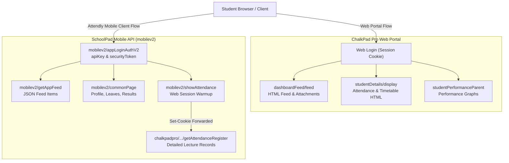

# CodeBrigade / ChalkPad Pro Integration Map & Reverse Engineering Investigation

**Investigation Target:** `https://cuiet.codebrigade.in` (Chitkara University Institute of Engineering & Technology)  
**Client Project:** Attendly Reconstruction (`X:\SEM3\reverse-engg`)  
**Investigation Tool:** REA (Reverse Engineer Anything) + Passive Authenticated Browser Observation  
**Operating Constraint:** Read-only observation of user's active session. Zero credential extraction or session replay.

---

## 1. Feature Integration Map

| Feature | Observed Source | Response Structure | Update Behavior | Integration Status |
| :--- | :--- | :--- | :--- | :--- |
| **Circulars & Notices** | `POST https://cuiet.codebrigade.in/dashboardFeed/filterFeedHtml/` and `POST /mobilev2/getAppFeed` | DynamoDB JSON format in Mobile API / Rendered HTML in Web portal (`.ui-feed`, notice ID, timestamp, read bit, sender) | Updates on new notice dispatch; polled via manual pull-to-refresh or page navigation | **Technically observable but permission to reuse is unconfirmed** (Category 2) |
| **Notice Attachments** | `GET https://cuiet.codebrigade.in/dashboardFeed/downloadAttachment/[idx][fileId]` and `/mobilev2/getAppAttachmentDetails` | Direct binary PDF/Doc/Image stream (`application/pdf`) with `Content-Disposition: inline/attachment` | Static asset once published; keyed by attachment ID and session cookie | **Technically observable but permission to reuse is unconfirmed** (Category 2) |
| **Attendance Report (Aggregates)** | `POST https://cuiet.codebrigade.in/studentDetails/displayAttendance/` and `POST /mobilev2/commonPage` (`commonPageId=28`) | Subject table: Subject code, Subject name, Teacher, Delivered, Attended, Absent, Duty Leave, Medical Leave, Percentage | Updates when faculty submits lecture records; refreshed on page reload | **Technically observable but permission to reuse is unconfirmed** (Category 2) |
| **Attendance Register (Sessions)** | `POST https://cuiet.codebrigade.in/chalkpadpro/studentDetails/getAttendanceRegister` (w/ session warmup) | HTML document containing `<thead>` period dates (`DD-MM`) and `<tbody>` cell statuses (`P`, `A`, `DL`, `ML`) per subject | Daily updates as attendance is marked by faculty; requires active PHP session | **Technically observable but permission to reuse is unconfirmed** (Category 2) |
| **Timetable / Schedule** | Web Portal: Embedded DHTML tab on `studentDetails/display` Mobile API: `commonPageId=85` (empty for current batch) / Derived from register | Web: Static weekly grid by weekday/period. Mobile: Derived dynamically from attendance register timestamps via `deriveTimetableFromRegister()` | Static per semester, refreshed when batch schedule revisions occur | **Technically observable but permission to reuse is unconfirmed** (Category 2) |
| **Personal Profile** | `POST https://cuiet.codebrigade.in/mobilev2/getUserDetails` and `chalkpadpro/studentDetails/display` | JSON / HTML: Student Name, Roll No, Reg No, Degree, Branch, Section, Email, Mobile, Blood Group, Father/Mother details, Photo URL | Static per academic year; cached locally | **Technically observable but permission to reuse is unconfirmed** (Category 2) |
| **Grades / Report Card** | `POST https://cuiet.codebrigade.in/studentPerformanceParent/graphDisplay` and `/mobilev2/commonPage` (`commonPageId=31`) | HTML Table: Semester, Subject Code, Name, Credits, Earned Grade (`A+`, `A`, `B+`, etc.), SGPA, CGPA | Published at end of semester evaluation; static historically | **Technically observable but permission to reuse is unconfirmed** (Category 2) |
| **Leave Management** | `POST https://cuiet.codebrigade.in/mobile/getCategoryNameApp` and `/mobile/getLeaveDetailsApp` | JSON list of leave categories (Duty, Medical, Casual) and submitted leave application statuses | On-demand submission & approval status refresh | **Technically observable but permission to reuse is unconfirmed** (Category 2) |

---

## 2. Classification of Data Sources & Permissions

1. **Officially Documented & Authorized Public APIs (Category 1)**:
   - **Status**: **None observed**. Chitkara University and CodeBrigade do not provide an open developer portal or documented public REST API for third-party client integrations.
2. **Technically Observable Private Endpoints (Category 2)**:
   - All examined endpoints (`/mobilev2/*`, `/dashboardFeed/*`, `/chalkpadpro/studentDetails/*`, `/studentDetails/*`) are private, internal backend routes designed solely for the first-party web portal and the official SchoolPad Android/iOS application.
   - Reusing these endpoints in a third-party app relies on session emulation and reverse-engineered request formats.
3. **Unavailable or Blocked Features (Category 3)**:
   - Direct Timetable via `commonPageId=85`: The university ERP currently does not populate the legacy SchoolPad mobile timetable table for current batches; it returns 0 rows.
   - Semester 2 & Semester 3 consolidated marks on `commonPageId=31`: Legacy mobile common page 31 currently only renders the most recent semester or incomplete marksheets depending on examination board publication status.

---

## 3. Discrepancy & Root Cause Analysis (Local App vs. Real Portal)

### A. Dashboard Data Integration & Why Live Data Was Incomplete
- **Confirmed Root Cause**:
  1. `commonPageId=28` (Subjectwise Attendance) returns an empty table on Chitkara's backend. The app initially had no fallback to ChalkPad Pro's register.
  2. The local Vite proxy (`vite.config.ts`) was originally unaware of web session warmup (`X-Warmup-Url` to `/mobilev2/showAttendance`). The web register endpoint (`/chalkpadpro/studentDetails/getAttendanceRegister`) requires active session cookies (`PHPSESSID`). Without the warmup step, requests failed with 302 redirect to login.
  3. Circular attachments: In the real portal, attachments are served from `/dashboardFeed/downloadAttachment/[index][attachmentId]`. The local app was attempting to parse attachment URLs from DynamoDB objects without authenticating the download request through the proxy.

### B. Semester 2 & Semester 3 Report Card Results
- **Confirmed Root Cause**:
  1. The legacy mobile endpoint (`commonPageId=31`) only renders rows that the ERP administrator has marked as "Published" for mobile view.
  2. Chitkara University publishes complete multi-semester marksheets under ChalkPad Pro's web performance module (`studentPerformanceParent/graphDisplay`), while the legacy mobile feed only had Semester 1 grades finalized.

### C. Timetable Loading
- **Confirmed Root Cause**:
  1. The official mobile timetable endpoint `commonPageId=85` returns 0 rows for this batch.
  2. The web portal renders the timetable as a static DHTML table, but the mobile app reconstructs it using statistical inference from the attendance register (`deriveTimetableFromRegister()`).

---

## 4. Architectural Comparison: Web Portal vs. Mobile API

---

## 5. Security & Session Architecture Recommendations

1. **Zero Credential Storage**:
   - Never store student passwords in `localStorage`, cookies, or application bundles.
   - The app only caches the temporary session tokens (`authToken`, `securityToken`, `deviceUUID`) returned after authenticating.
2. **Session Expiration Handling**:
   - Chitkara ERP session tokens expire after a university-enforced TTL (typically 24 hours to 7 days).
   - When an endpoint returns HTTP 401, status `4`, or a login redirect, the client must gracefully clear local session caches and prompt the student for fresh authentication.
3. **Data Minimization & Read-Only**:
   - The application must remain strictly read-only.
   - Restrict requests to student-specific read endpoints: `/getUserDetails`, `/getAppFeed`, `/getAttendanceRegister`, `/getReportCard`.
   - Never expose administrative or record-altering endpoints.
